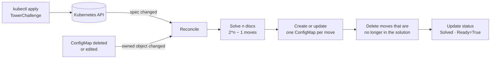

# k8s-hanoi-operator

[](https://github.com/MosesKing/k8s-hanoi-operator/actions/workflows/test.yml)
[](https://github.com/MosesKing/k8s-hanoi-operator/actions/workflows/test-e2e.yml)
[](https://github.com/MosesKing/k8s-hanoi-operator/actions/workflows/lint.yml)

A Kubernetes operator, written in Go with [Kubebuilder](https://book.kubebuilder.io), that solves the Tower of Hanoi. You declare a `TowerChallenge` with a number of discs; the operator writes the solution into the cluster as one ConfigMap per move and keeps it in sync.

The puzzle is a toy. The point is the operator pattern done properly: a declarative API with validation, an idempotent reconcile loop, owner references and garbage collection, self-healing, status conditions, least-privilege RBAC, and tests at three levels.

*Opérateur Kubernetes en Go (Kubebuilder) : une ressource `TowerChallenge` décrit le puzzle, l'opérateur écrit la solution en ConfigMaps et la garde synchronisée. Validé par des tests unitaires, des tests contre un vrai API server (envtest) et des tests de bout en bout sur un cluster kind.*

```console
$ kubectl apply -f config/samples/hanoi_v1alpha1_towerchallenge.yaml
towerchallenge.hanoi.mosesking.github.io/towerchallenge-sample created

$ kubectl get tc
NAME                    DISCS   MOVES   PHASE    AGE
towerchallenge-sample   4       15      Solved   3s

$ kubectl get cm -l hanoi.mosesking.github.io/challenge=towerchallenge-sample -o custom-columns=NAME:.metadata.name,MOVE:.data.move
NAME                              MOVE
towerchallenge-sample-move-0001   Move disc 1 from A to B
towerchallenge-sample-move-0002   Move disc 2 from A to C
towerchallenge-sample-move-0003   Move disc 1 from B to C
...
towerchallenge-sample-move-0015   Move disc 1 from B to C
```

## How it works



On every pass the reconciler compares the cluster with the solution for `spec.discs` and fixes the difference:

| Event | What the operator does |
|---|---|
| Challenge created | Writes `2^n − 1` ConfigMaps, sets `status.phase: Solved` and `Ready=True` |
| `discs` lowered (4 → 3) | Deletes moves 8 to 15, keeps 1 to 7 untouched |
| `discs` raised (3 → 5) | Adds the missing moves, rewrites the ones that changed |
| A move is deleted or edited by hand | Puts it back exactly as it was |
| Challenge deleted | Nothing to do: every ConfigMap has an owner reference, so Kubernetes garbage-collects them |
| Nothing changed | Nothing is written. A second pass never touches the API (tested) |

## Design decisions

- **The API validates input, not the controller.** `discs` must be between 1 and 10 (`+kubebuilder:validation` markers in the CRD). 10 discs is already 1,023 ConfigMaps, so the cap protects the cluster.
- **Owner references instead of finalizers.** Every move is controlled by its challenge. Deleting the challenge cleans up through the garbage collector, with no custom cleanup code to get wrong.
- **Idempotent and level-triggered.** Reconcile uses `CreateOrUpdate` and only writes when something differs, so it can run any number of times. Status is only updated when the result changes.
- **Watches what it owns.** The controller reacts to spec changes on challenges (`GenerationChangedPredicate`, so status updates do not loop) and to any change on its own ConfigMaps, which is what makes it self-healing.
- **Never deletes what it does not own.** A ConfigMap that carries the label but not the owner reference is left alone (tested).
- **Least privilege.** The controller can read challenges and write their status, and manage ConfigMaps. Nothing else.
- **Readable output.** ConfigMap names are zero-padded (`-move-0001`), so `kubectl get` lists them in order.

## Tests

| Level | What | Where |
|---|---|---|
| Unit | The solver replays every solution from 1 to 12 discs on three rods and checks the rules: only the top disc moves, never onto a smaller disc, all discs end on C, in exactly `2^n − 1` moves | [`internal/hanoi`](internal/hanoi/solve_test.go) |
| Controller (envtest, real API server) | Writes owned ConfigMaps and `Ready=True` · second pass changes nothing · resize down and up · repairs a deleted and an edited move · leaves foreign ConfigMaps alone · CRD rejects 0, negative and 11 discs | [`internal/controller`](internal/controller/towerchallenge_controller_test.go) |
| End to end (kind cluster) | Builds the image, deploys the operator, checks the metrics endpoint, then: solve 4 discs → shrink to 3 → delete a move and watch it come back → delete the challenge and watch the garbage collector remove every move | [`test/e2e`](test/e2e/e2e_test.go) |

All three run in GitHub Actions on every push, with `golangci-lint`.

## Run it

Requirements: Go 1.26, Docker, [kind](https://kind.sigs.k8s.io), kubectl.

```bash
make test        # unit + controller tests (downloads envtest binaries)
make lint        # golangci-lint
make test-e2e    # creates a kind cluster, deploys, runs the scenario, deletes the cluster
```

Try it by hand on a local cluster:

```bash
kind create cluster
make docker-build IMG=hanoi-operator:dev
kind load docker-image hanoi-operator:dev
make install deploy IMG=hanoi-operator:dev
kubectl apply -f config/samples/hanoi_v1alpha1_towerchallenge.yaml
kubectl get tc -w
```

## Project history

I first built this in 2024 as a platform engineering take-home on Kubernetes and Crossplane. That version worked on my cluster but had real bugs: the API was declared cluster-scoped while the controller wrote into a namespace, the only test could never pass, nothing linked the ConfigMaps to their challenge, and there was no limit on discs. In 2026 I rebuilt it on current Kubebuilder (controller-runtime 0.25, Kubernetes 1.37 client libraries), fixed those issues and added the test suite above.

## License

Apache 2.0
